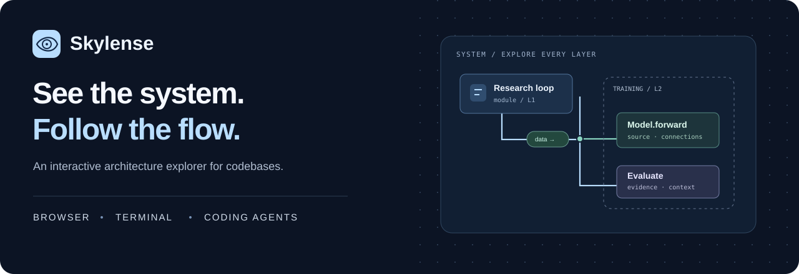
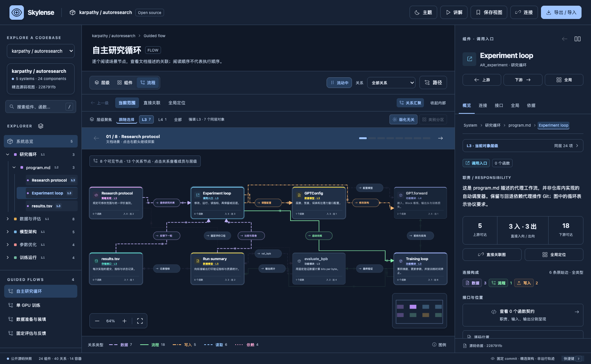
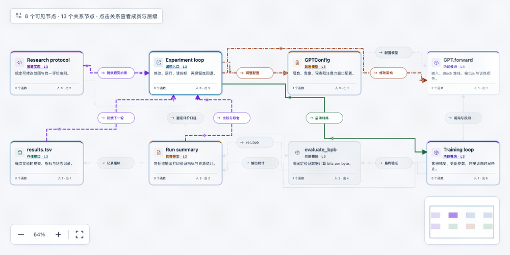
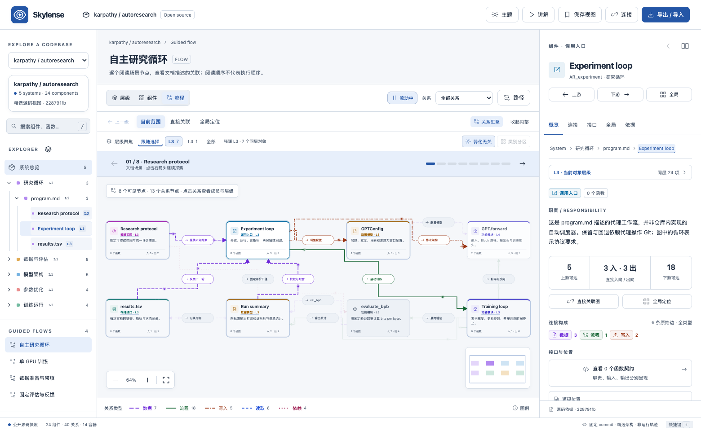
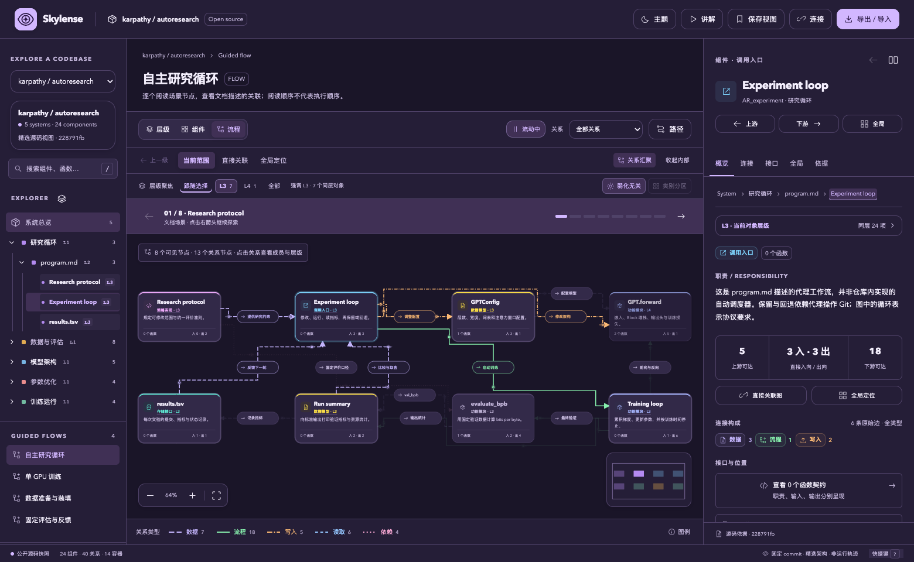

<div align="center">



**An interactive architecture explorer for codebases.**

Explore the hierarchy. Follow a connection. Open the source behind it.<br>
One connected map for your browser, terminal, and coding agent.

### [Open Skylense ↗](https://danielchen26.github.io/skylense-app/app/?open=source) &nbsp; · &nbsp; [Download offline ↓](https://github.com/danielchen26/skylense-app/releases/download/v0.5.1/skylense-0.5.1-web-preview.zip)

**No account · Offline-ready · Six themes · Source-linked**

[Website](https://danielchen26.github.io/skylense-app/) · [Terminal & MCP](#terminal--mcp) · [中文](README.zh-CN.md) · [Release notes](https://github.com/danielchen26/skylense-app/releases/tag/v0.5.1)

</div>



## From a codebase to a clearer picture

| Your question | Your next move |
| --- | --- |
| **Where does this fit?** | Expand from systems to modules and components. Keep parent and global context in view. |
| **Where should I start reading?** | Choose a source guide by its entry file or symbol, relationship type and module. See the same objects highlighted in the tree. |
| **What connects these points?** | Build a route with chosen intermediate stops, inspect each relationship, and compare bounded alternatives. |
| **What happens along this flow?** | Walk through curated scenarios with animated direction cues and connected details. |
| **Where is the evidence?** | Open source excerpts, commit-pinned links, inputs, outputs, and individual edge details. |
| **How can I explain it?** | Save your reading position or use presentation mode to guide someone through the map. |



*Actual app recording. Animation shows direction in the source map; it is not live execution or measured traffic.*

## Download. Unzip. Explore.

1. **[Download the Web app](https://github.com/danielchen26/skylense-app/releases/download/v0.5.1/skylense-0.5.1-web-preview.zip).**
2. Extract the `skylense-web` folder.
3. Open **`standalone.html`** in a modern desktop browser.

No Node.js installation, API key, account, or build step is needed for the Web app. Prefer to try it first? **[Open the live app](https://danielchen26.github.io/skylense-app/app/)**.

> **0.4 source indexing.** Open your own folder, selected files, public GitHub repository or webpage. Full indexing is the default, with 24 bundled syntax grammars, incremental syntax reuse and project-aware relationships. Version 0.4.1 also verifies and reuses unchanged public GitHub files while rebuilding the complete source map. Source previews, parser diagnostics, unresolved targets and external dependencies remain explicit. The interface is primarily Chinese. [Source guide and evidence boundaries](guides/SOURCES.md).

Automatic analysis does **not** make every repository or folder match the curated Demo. The interactive workbench is already shared; the depth of automatic understanding is not.

| Capability | Current status |
| --- | --- |
| Hierarchy, animated orthogonal edges, node/edge details, upstream/downstream, global location, waypoint paths, themes and export | Shared complete interface |
| Automatic folders, files, declarations and code relationships | Implemented; parse depth differs by language |
| Demo business-module boundaries, role explanations, input/output contracts and end-to-end scenarios | Not all generated automatically; examples include authored content |
| Any language, any scale, complete runtime relationships | Not guaranteed; unresolved content and resource ceilings are reported |

Automatic analysis copies source parameters, explicit return types and recognizable docstrings for supported declarations. `sourceContract` records `complete`, `unannotated`, `unsupported` and `partial` separately. An empty array with `unsupported` means the parser did not read the signature — not that the source has no annotation. These arrays are not authored Demo contracts. Twenty-four syntax grammars are not twenty-four complete semantic analyzers. Source-backed notes come from declarations, signatures and docstrings — not invented business roles or runtime scenarios.

## Bring your own source

In the Web app, choose **打开来源 / Open source**. Select a folder or files, enter a public URL, or paste text/HTML. Review the coverage report, then enter the same full workbench.

With the Agent toolkit installed:

```sh
skylense open /path/to/project
skylense open https://github.com/owner/repo
skylense open https://example.com
skylense analyze /path/to/project --output architecture.json
skylense bundle /path/to/project --output architecture.html
skylense enrich /path/to/project --host claude --output architecture.html
```

The toolkit includes the complete Web app. Local `open` handles public webpages that block direct browser CORS; it never executes source code or website scripts. The default indexes every eligible file, including supported declarations after the former preview limits. An explicit `--max-files 300` requests a smaller partial preview. Existing Skylense JSON opens with its authored contracts, scenarios and source evidence intact. [Source guide](guides/SOURCES.md) · [Agent model authoring](guides/MODEL.md).

`bundle` writes the same workbench with one analysed model as a single HTML file that opens from disk with no install, server or network — about 1.4 MB plus the model gzip-compressed and base64-encoded (a third larger than its compressed size), so it can be sent to someone. It is a viewer: analysing another source from inside it is refused with a reason.

`enrich` adds the layer the curated examples have and a parser cannot produce: responsibility regions (a large file can be split by declaration), what each key object is for and what it takes and returns, why regions depend on each other, task scenarios from real entry points, and a reading guide. A language model you name writes it (`--host claude`, or any `--host command`); every sentence cites snapshot lines that Skylense slices and digest-checks itself, and a separate verifier call grades each sentence 已核验 / 部分核验 / 未核验 on the surface. Derived structure is never changed, `--budget` (default 4 USD) bounds the spend, and a run can be recorded and replayed byte for byte. Source excerpts are sent to the host you name. [Authoring contract](docs/AUTHORING.md).

## Read the connection, then inspect its evidence

- **Syntax and hierarchy:** Tree-sitter declarations keep real file, class, function and nested-scope boundaries. Unchanged file syntax is reused locally by content hash.
- **Project relationships:** included manifests help resolve local imports and aliases. JavaScript/TypeScript call sites use the TypeScript checker when a target is available in the indexed source.
- **Julia method sets:** static bindings expose possible methods separately as dispatch candidates. Candidate edges share a call-site identity; runtime argument dispatch is not guessed.
- **External references:** package nodes are explicitly unfetched. Source collection completeness, parser errors and preview shortening are reported separately.

The same full workbench handles generated and curated maps. Static dependency guides support exploration; they do not claim an observed execution order. Full indexing stops explicitly when a resource ceiling is reached instead of silently dropping the rest of a repository. [Detailed capabilities and ceilings](guides/SOURCES.md).

## A guide into the same map

The module tree shows **where code lives**. Source guides show **which connected objects to read together**. Since 0.4.2, cards use a short file or symbol name, compact module context, relationship purpose and exact object/edge counts. Source modules appear first; examples, tests, documentation and tools are grouped separately.

Switch between the current module and all guides. Opening a guide highlights its objects and ancestor folders in the tree; selecting an object in the graph or the guide's dropdown keeps the reading position in sync. Use **在目录中定位 / Locate in tree** to inspect its location, or **返回原位置 / Return** to resume your previous view. Existing exported JSON also receives readable guide cards without changing its authored nodes, relationships or evidence.

Guides are selected static neighborhoods with possible branches, not execution traces. Every original relationship remains available in the full map and path search.

## Start with a real AI codebase

| Map | What you can explore |
| --- | --- |
| **[autoresearch →](https://danielchen26.github.io/skylense-app/app/?example=autoresearch)** | Research iterations, GPT training, optimization, and evaluation. |
| **[LangGraph →](https://danielchen26.github.io/skylense-app/app/?example=langgraph)** | Graph compilation, Pregel execution, state channels, and checkpoints. |
| **[vLLM →](https://danielchen26.github.io/skylense-app/app/?example=vllm)** | Requests, inference scheduling, KV cache, and GPU execution. |

These are selected core paths through fixed source revisions, with authored reading groups and attributed excerpts. [Source and license notices](EXAMPLE_NOTICES.md).

## Six themes. Keep your perspective.

**Porcelain · Jade · Sandstone · Midnight · Graphite · Aurora**

Switch with **T** while preserving your selection, reading position, and zoom. Surfaces, typography, and geometry change together; component identities and relationship meanings stay intact.

<p align="center">
 
</p>

[**Try all six theme previews →**](https://danielchen26.github.io/skylense-app/#themes)

## Terminal & MCP

Use the same model in an interactive terminal, through JSON output, or from a compatible coding agent.

Download the **[Agent & Terminal toolkit](https://github.com/danielchen26/skylense-app/releases/download/v0.5.1/skylense-0.5.1.tgz)**. With **Node.js 22+**, install the downloaded file:

```sh
npm install -g /absolute/path/to/skylense-0.5.1.tgz
skylense config --root /path/to/project
```

Copy the printed configuration into a client that supports **local stdio MCP**. Typical call order:

1. `skylense_analyze({"source":"."})` — analyze the configured project.
2. `skylense_search`, `skylense_inspect`, `skylense_traverse`, `skylense_path` with `repo: "analyzed"`.
3. `skylense_view({"repo":"analyzed"})` — local URL for the complete page; keep the MCP process running.

Without MCP, an agent that can run commands can use:

```sh
skylense analyze /path/to/project --output architecture.json
skylense open architecture.json --no-browser --json
```

To approach Demo-level explanation, an agent can read source, add attributed roles and contracts using the [model contract](guides/MODEL.md), then show the same page. That step is not a built-in one-click flow.

Arrow keys in `skylense tui` navigate; **Enter** expands; **Tab** switches panels; **u / d** follows upstream or downstream relations; **/** searches.

Nine MCP tools let an agent **analyze sources, export models, list, search, inspect, traverse, plan waypoint paths, read scenarios, and open visual views**. [**Agent setup and local Web links →**](guides/AGENTS.md) · [**Terminal controls →**](guides/TERMINAL.md)

## Pick the right download

| Download | Includes | Requires |
| --- | --- |
| **[Web ZIP](https://github.com/danielchen26/skylense-app/releases/download/v0.5.1/skylense-0.5.1-web-preview.zip)** | Interactive explorer, six themes, all three maps, offline HTML | Modern desktop browser |
| **[Agent toolkit](https://github.com/danielchen26/skylense-app/releases/download/v0.5.1/skylense-0.5.1.tgz)** | Source analyzer, full local Web app, CLI, terminal and MCP server | Node.js 22+ |
| **[Checksums](https://github.com/danielchen26/skylense-app/releases/download/v0.5.1/SHA256SUMS.txt)** | SHA-256 for both files | Optional integrity check |

Choose the named ZIP or TGZ above, rather than GitHub's automatically generated source archives. A native macOS installer is not included yet.

## Local by design. Explicit when connected.

The downloaded Web app can run offline. Imported model JSON stays in the current page session; reusable syntax facts are cached locally. The CLI reads selected folders/files or public URLs. MCP local source access is confined to an explicitly configured root. Neither executes the displayed repositories or page scripts.

A connected agent receives query results and may send them to its configured model provider. Browser imports do not automatically sync to that process. [Data boundaries](PRIVACY.md).

## Help shape the next view

[Report a confusing connection or a bug](https://github.com/danielchen26/skylense-app/issues/new?template=bug_report.yml). Include the example, selected object, and steps to reproduce. Share a public-example screenshot with a teammate who is learning the same codebase.

> **Share Skylense:** An interactive code architecture explorer. Follow layers and connections, inspect the source, and use the same map in your browser, terminal, and coding agent.

**Preview distribution.** You may download and run the provided unmodified application preview. Skylense is not offered under an open-source license; source licensing and commercial rights remain reserved. Upstream example materials retain their own licenses. [Preview notice](NOTICE.md).

---

<p align="center"><b>Skylense</b> · See every layer. Follow every connection.</p>
