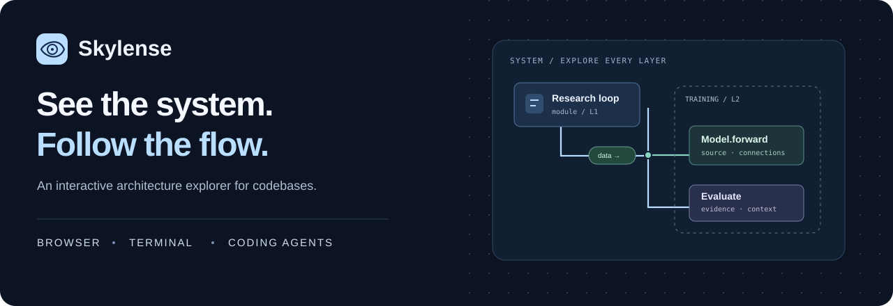
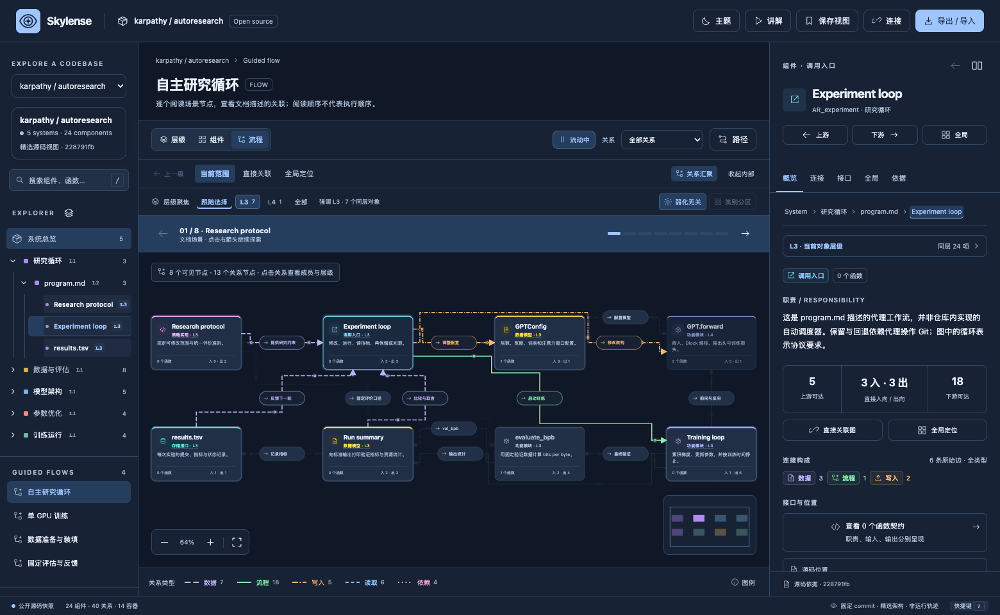
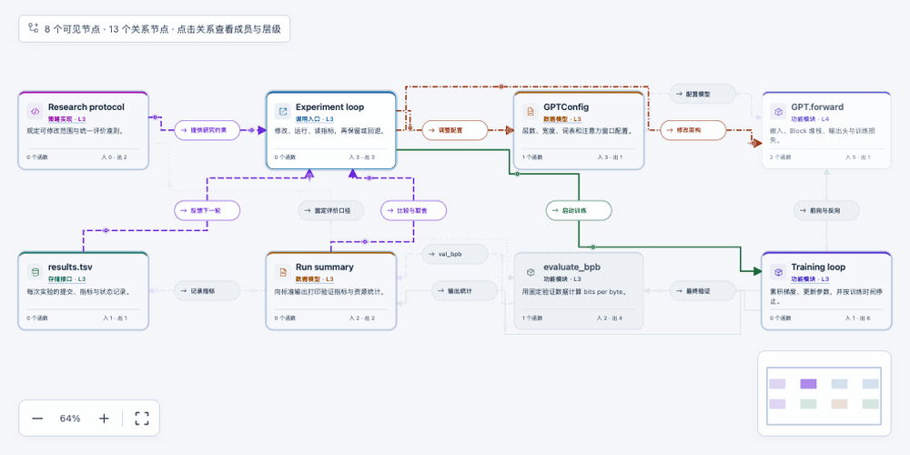

<div align="center">


**让代码架构成为一张可以探索的地图。**

逐层展开结构、追踪上下游、查看源码依据。网页、终端与 Agent 共用同一份模型。

### [在线体验 ↗](https://danielchen26.github.io/skylense-app/app/?open=source) · [下载离线版 ↓](https://github.com/danielchen26/skylense-app/releases/download/v0.5.0/skylense-0.5.0-web-preview.zip)

无需账号 · 可离线运行 · 六套主题 · 源码依据

[English](README.md) · [产品主页](https://danielchen26.github.io/skylense-app/) · [发布记录](https://github.com/danielchen26/skylense-app/releases/tag/v0.5.0)
</div>



## 三步开始

1. 下载 **[Web ZIP](https://github.com/danielchen26/skylense-app/releases/download/v0.5.0/skylense-0.5.0-web-preview.zip)**。
2. 解压 `skylense-web` 文件夹。
3. 在现代桌面浏览器中打开 **`standalone.html`**。

网页版无需 Node.js、API Key 或构建步骤。也可以直接[在线打开](https://danielchen26.github.io/skylense-app/app/)。

## 把一个问题一路读下去

- **层级结构**：从系统到模块、组件，向下展开并保留父级与全局位置。
- **源码导览**：从短文件名或函数名选择阅读入口，直接看到关联类型、所属位置与对象 / 关系数量，并在目录中同步高亮。
- **关系探索**：直角连线、上下游联动、类别分区与同层高亮；路径可以加入中间必经节点。
- **流程讲解**：按场景阅读，动态提示方向，随时暂停或进入讲解模式。
- **源码依据**：查看节点、函数与每条原始边的说明、短源码摘录和固定 commit 链接。
- **六套主题**：瓷白、青玉、砂岩、深海、石墨、极光。按 `T` 切换，位置与缩放保持不变。



现在可以点击 **打开来源**，选择文件夹、多个文件，输入公开 GitHub / 网页 URL，或粘贴文本 / HTML。默认完整索引符合规则的文件，不再只取前 300 个文件。报告分别显示文件覆盖、解析诊断、未解析关系、外部依赖与预览长度，确认后进入同一套完整工作台。

0.4 内置 **24 套 Tree-sitter 语法**，支持 Python、JavaScript / TypeScript、Julia、Go、Rust、C/C++ 等语言的声明与源码关系。文件、类、函数和嵌套结构可以逐层查看；未改变的文件复用本地增量语法缓存。0.4.1 还会在确认 GitHub 最新提交和文件哈希后复用未改变的公开文件，完整重建关系图。

- **JS / TS 调用**：通过 TypeScript checker 连接到已索引的源码声明，并注明静态绑定依据。
- **Julia 方法集**：结合模块、include 与显式导入，显示可能的方法候选；候选边与已解析调用区分，不猜测运行时多分派。
- **外部依赖**：独立显示包引用，并标明源码未抓取；不把外部包当成已完整解析的本地代码。
- **完整索引与预览分离**：保留所有支持的节点、声明与关系身份。长源码预览可以缩短，但仍保留行号、有效摘录及来源。资源不足时明确报错，不把丢失后半个仓库的结果标成完整。

完整文件集合不等于任意语言的完整运行时调用图。动态行为、解析错误和不确定目标均保留说明；PDF、Office、图片、权重和压缩包展示元数据。[来源能力与资源上限](guides/SOURCES.md)。

还不能说「任何仓库或文件夹都能自动达到 Demo 的完整效果」。目前是交互功能已经通用，自动理解的深度还没完全达到。

| 能力 | 当前状态 |
| --- | --- |
| 层级展开、直角动态连线、节点／边详情、上下游、全局定位、多路标路径、主题与导出 | 已共用同一套完整界面 |
| 自动提取目录、文件、声明和代码关系 | 已实现，但不同语言的解析深度不同 |
| Demo 中的业务模块划分、职责解释、输入输出契约、端到端场景 | 尚未全部自动生成；示例包含人工整理的内容 |
| 任意语言、任意规模、完整运行时关系 | 不能保证；未解析内容和资源限制会单独报告 |

自动分析对已支持的声明形式提取源码参数、显式返回类型及可识别的文档字符串，并用 `sourceContract` 分别记录 `complete`、`unannotated`、`unsupported` 和 `partial`。空数组如果是 `unsupported`，表示解析器没读到签名，**不是**源码没有注解。这不是 Demo 里人工整理的业务契约。24 套语法解析器也不等于 24 套完整语义分析器。

仍内置 **autoresearch、LangGraph、vLLM** 三个固定版本的精选语义模型供体验。

## 目录与导览，读的是同一张图

上方目录回答“代码放在哪里”，下方 **源码导览** 回答“从哪个入口开始，把哪些关联对象一起读”。自 0.4.2 起，卡片用短文件名 / 函数名作为卡片标题，路径退到辅助位置；同时标明导入、调用关联、资源链接或混合关系，以及实际对象数和关系数。源码模块优先推荐，示例、测试、文档与工具分组展示。

可以选择 **当前模块** 或 **全部** 导览。进入导览后，同一批对象及其上级目录会高亮；点击画布对象或使用对象下拉框，阅读位置同步更新。**在目录中定位** 可查看所在层级，**返回原位置** 可继续此前的探索。旧版导出 JSON 也能显示清楚的导览卡片，保留原有节点、关系和源码依据。

导览可以包含分支，表示静态源码关联的阅读入口，不代表实际执行顺序；完整关系仍可在结构图、上下游和路径工具中探索。

## 当前分析范围

Agent 现在可以通过 MCP 或 CLI 使用。下载 [0.5.0 工具包](https://github.com/danielchen26/skylense-app/releases/download/v0.5.0/skylense-0.5.0.tgz)，安装 Node.js 22+，然后执行；把项目路径换成实际存在的目录：

```sh
npm install -g ./skylense-0.5.0.tgz
skylense config --root "/你的项目目录"
```

把输出配置加入支持 **本地 stdio MCP** 的 Agent。典型调用顺序是：

1. `skylense_analyze({"source":"."})`：分析配置的项目。
2. 使用 `skylense_search`、`skylense_inspect`、`skylense_traverse`、`skylense_path`，指定 `repo: "analyzed"`，查询代码与关系。
3. `skylense_view({"repo":"analyzed"})`：返回完整交互网页的本地地址；MCP 进程需要保持运行。

没有 MCP、但能运行命令的 Agent，也可以：

```sh
skylense analyze "/你的项目目录" --output architecture.json
skylense open architecture.json --no-browser --json
```

如需主动缩小分析范围，可用 `skylense analyze /path/to/project --max-files 300 --output quick-preview.json`；这会明确进入部分预览模式。默认完整索引设置了有限资源上限：单个文本 64 MiB、源码总量 256 MiB、模型 128 MiB，以及文件数量和层级安全上限。达到上限会停止并说明原因。

要达到 Demo 的解释深度，Agent 目前可以进一步阅读源码、按[模型契约](guides/MODEL.md)补充职责和契约，再交给同一个页面展示；这一步还不是 Skylense 内置的一键自动流程。

[Agent 接入与本地网页说明](guides/AGENTS.md) · [终端操作](guides/TERMINAL.md)。工具包已包含完整网页。公开内置示例的旧链接可用 `skylense serve --port 4173`。浏览器导入的模型不会自动同步到 Agent。

## 数据与发布方式

浏览器导入的模型 JSON 留在当前页面会话；增量语法事实缓存在本地。MCP 将查询结果返回给你连接的 Agent，是否发送给模型服务商由该客户端决定。[数据说明](PRIVACY.md)。

Skylense 提供可下载、可运行的未修改应用预览，保留源码授权和后续商业化决定。**Skylense 本身不是 MIT 或 Apache 开源项目**；示例材料仍遵循各自的第三方许可证。[预览声明](NOTICE.md) · [示例来源与许可证](EXAMPLE_NOTICES.md)。

本次提供 Web 与本地 Node 工具包，尚无原生 macOS 安装包。[反馈问题](https://github.com/danielchen26/skylense-app/issues/new?template=bug_report.yml)。
